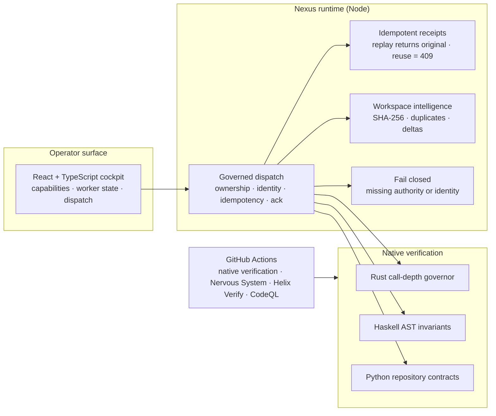

# Pro-Code · Governed Local Engineering Operator

**A local engineering operator that distinguishes executable operations, declared roles, failed attempts and actually verified results.** It pairs a React/TypeScript cockpit with a dependency-free Node "Nexus" runtime, fail-closed worker dispatch, idempotent receipts, automatic workspace intelligence, and native verification in Rust and Haskell.

[](https://github.com/GlacierEQ/pro-code/actions/workflows/ci.yml)
[](https://github.com/GlacierEQ/pro-code/actions/workflows/nervous-system-contract.yml)
[](https://github.com/GlacierEQ/pro-code/actions/workflows/helix-verify.yml)
[](https://github.com/GlacierEQ/pro-code/actions/workflows/codeql.yml)

Built by [Casey Barton](https://casey-barton-glaciereq.vercel.app), forward-deployed AI engineer · [LinkedIn](https://www.linkedin.com/in/caseybartonai) · part of the [Job-App Helix](https://github.com/GlacierEQ/job-app-helix) portfolio.

## What this proves

- **Bounded local dispatch, enforced in code.** The Nexus runtime ([`server/nexus.mjs`](server/nexus.mjs)) validates worker ownership, case/trace/task/idempotency identity, bounded constraints, and explicit acknowledgement before it reports success. Anything else fails closed.
- **Single-process replay handling.** An identical replay returns the original receipt (`X-Idempotent-Replay: true`). Reusing a key with a different envelope is rejected with `409`. Both cases are tested in `server/nexus.test.mjs`.
- **Polyglot native verification.** Each layer is tested in its own language on every push: TypeScript/React (Vitest), Node runtime (`node --test`), Python repository contracts (`unittest`), a Rust call-depth governor, and Haskell AST validity invariants.
- **Security and contract gates in CI.** Four workflows run on `main`: native verification, Nervous System Contract, Helix Verify, and CodeQL.
- **One implemented worker action: `inventoryWorkspace`.** A bounded recursive inventory produces SHA-256 hashes where policy permits, exact duplicate groups, change deltas, category summaries, and evidence-ranked candidates. Unrelated declared capabilities (AI inference, legal analysis, motion generation, etc.) return `501 unsupported` rather than treating the inventory as their completed work.
- **Truthful outcomes by default.** Every dispatch envelope must declare `external_actions: forbidden` or it is rejected. The response must identify the exact operation, matching task and case, objective completion, and evidence. Browser dispatch checks are not authorization; deploy behind a trusted auth boundary before exposing beyond a local trusted interface.

## Architecture



## Executable semantic code knowledge

`npm run code:knowledge -- --symbol workersManager --definition-file src/workers.ts --out .pro-code/runtime/symbols.json` now queries **compiler-resolved symbol identity**, rather than matching raw text. It reports the exact declarations, type information, reference sites with file/line/column evidence, and independently identified symbols with the same spelling. Its `--definition-file` selector narrows ambiguity without hiding references in other modules. Optionally combine with `--impact src/workers.ts` to include reverse-dependency impact from the same TypeScript program.

`npm run test:code-knowledge` exercises real compiler behavior, detects false identity merging, preserves compiler diagnostics, tests missing-symbol failure, and executes the CLI in a fresh fixture. The standard `npm test` also runs this suite and queries `workersManager` on the real repo.

Scope is honest: static TypeScript project symbols and configured files, **not** live runtime data flow, arbitrary reflection, all languages, or a replacement for CodeQL/security analysis. Source code is the authority; research references inform engineering choices rather than certify execution.

## Executable TypeScript code intelligence

The repository includes a real compiler-backed analysis command, rather than a prose-only 'code intelligence' claim:

```bash
npm ci
npm run code:inspect -- --impact src/workers.ts --out .pro-code/runtime/impact.json
npm run test:code-intelligence
```

This resolves static/re-export, literal dynamic imports and CommonJS `require()` / `require.resolve()` dependency edges using TypeScript's compiler API. New explainable impact reports list direct dependents and deterministic shortest paths to all transitively affected files; compiler symbol binding checks exclude local functions and parameters named `require`. It enumerates module exports, reports actual compiler diagnostics and unresolved imports, and computes transitive reverse dependencies for the requested file. The report is machine-readable JSON with exact file paths, counts, limitations and compiler version. Nonliteral module paths are explicitly unknown, and unresolved references cause `scope.analysis_complete` to be `false`. Use `--fail-on-incomplete` to return a nonzero exit code for incomplete dependency graphs (in addition to `--fail-on-diagnostics` for compiler errors); a JSON report is still written for investigation. Files outside the configured TypeScript project are not silently counted as analyzed. Ambient/global `require` references remain statically analyzed; real runtime module-loader behavior is not proven. This is a developer/CI tool using the existing TypeScript dev dependency, not a deployed Nexus worker or a claim that every language is analyzed.

## Compiler-backed code completion

The `code:complete` CLI uses the actual TypeScript language service and the project's `tsconfig.json`, including cross-file types and imported symbols. Suggestions are deterministic and machine-readable; no model calls, editor extension, file mutations, or autonomous patch claims are implied.

```bash
npm ci
npm run code:complete -- --file src/workers.ts --line 1 --column 1 --limit 25
npm run test:code-completion
```


### Compiler-resolved completion details and diagnostics

Use the opt-in TypeScript language-service details when a suggestion needs an import, and include syntax/semantic diagnostics for the target file:

```bash
npm run code:complete -- --file src/workers.ts --line 1 --column 1 --limit 25 --details --diagnostics
```

`--details` asks TypeScript for symbol information, documentation and **real compiler-proposed code actions** (including auto-import text changes, file-relative paths and exact spans). It does **not** apply those edits, install packages, or certify the result. Text changes outside the resolved workspace are not surfaced. `--diagnostics` adds compiler syntax and semantic diagnostics with error codes and 1-based locations. Both switches are optional to keep ordinary completion fast. `--fail-on-diagnostics` also emits the machine-readable report, then exits nonzero if the active source/editor buffer contains diagnostics. Code actions report `safe_workspace_scope` and reject symlink escapes; they remain read-only proposals to apply against an exact matching editor revision. Validate edits with the compiler, tests and repository CI before using them in production.

Positions use **1-based lines and columns**. Pass `--root` and `--config` for a different project and `--prefix` to filter suggested names. Results include insertion text, replacement spans where offered, compiler version, and flags for snippets and completion entries requiring additional import/code actions. The command rejects target files outside the workspace, symlink escapes, excluded project files, invalid positions, and unbounded output. No result may be represented as a compiled or applied patch; import code actions need a proper editor/integration before insertion.

## Executable compiler-aware refactoring

`code:refactor` adds actual cross-file TypeScript symbol renames to the existing completion, compiler-inspection, and symbol-knowledge tools. It uses TypeScript's rename locations, not text search; unrelated same-spelling local symbols stay untouched.

```bash
# Read-only plan, with exact source/output SHA-256 and per-file edits
npm run code:refactor -- --file src/workers.ts --line 1 --column 1 --new-name replacementName

# Apply only when explicitly requested
npm run code:refactor -- --file src/workers.ts --line 1 --column 1 --new-name replacementName --apply

npm run test:code-refactor
```

The selected cursor must point to a renameable identifier, using 1-based line/column coordinates. Preview never writes. The engine rejects files outside the configured TypeScript project or the workspace, realpath escapes, invalid identifiers, overlapping edits, change-bound overruns, and renames that introduce new compiler diagnostics. Each affected file must still match the preview's observed SHA-256 before any write; the apply step uses same-directory atomic file replacements and verifies readback hashes. A later write failure triggers best-effort rollback of already changed files. **This is not a crash-safe multi-file transaction**: interruption between writes can leave partial changes, so use Git and CI for durable rollback/recovery. The tool does not perform GitHub pushes or bypass connector consent.

## Run it

```bash
npm ci
npm run lint && npm run typecheck
npm test            # Vitest + node --test
npm run build

python -m unittest discover -s tests -p 'test_*.py' -v

rustc --edition 2021 --test src/governor.rs -o /tmp/pro-code-governor-tests && /tmp/pro-code-governor-tests
ghc -Wall -Werror -isrc tests/ASTValidatorSpec.hs -o /tmp/pro-code-ast-tests && /tmp/pro-code-ast-tests
```

Version `0.2.0` · canonical branch `main` · posture `LOCAL_OPERABLE`. Each source change has to earn a fresh CI receipt, so check the badges above for the current head.

---

## Engineering anatomy

### 1. Local Nexus runtime

[`server/nexus.mjs`](server/nexus.mjs) owns the local HTTP boundary.

It currently provides:

- `/health` with the declared worker registry and automation state;
- governed worker dispatch using the existing case-scoped envelope contract;
- worker/capability ownership validation;
- matching `X-Case-Id`, `X-Trace-Id`, and `Idempotency-Key` guards;
- bounded request bodies and explicit constraints;
- single-process in-memory idempotent receipts and conflicting-key rejection (not crash-safe multi-node exactly-once semantics);
- session-context storage;
- optional filesystem memory snapshots only when a target directory is explicitly configured;
- static serving of the built `dist` application;
- automatic-operator status/run endpoints when automation is attached.

```text
operator / client
      │
      ▼
local Nexus HTTP runtime
      │
      ├── reject malformed / unknown / mismatched dispatch
      │
      ├── preserve idempotency + receipt identity
      │
      ├── invoke a registered local automation handler when available
      │
      └── otherwise return 501 unsupported, with no false completion receipt
```

A worker registry entry is a declared role, not a deployed service, and is shown as `declared` by default. The runtime advertises exactly which capabilities have an executable handler in `/health.supported_capabilities`; the browser disables all others. No local handler means `501 unsupported`. Only the inventory handler currently has an end-to-end success path.

### 2. Automatic workspace operator

[`server/automation.mjs`](server/automation.mjs) performs bounded local workspace analysis. `npm run dev`, `npm run runtime`, and `npm start` use the automatic runtime path.

The operator can:

- recursively inventory the configured workspace;
- exclude `.git`, `.pro-code`, `node_modules`, `dist`, `coverage`, `tmp`, and symbolic-link noise;
- classify common document/data/media/archive/code file types;
- hash eligible files with SHA-256 under configurable size limits;
- detect exact duplicate groups;
- compare a new inventory with the prior manifest and record added/modified/removed paths;
- rank likely evidence-oriented candidates using explicit filename/category heuristics;
- atomically write:
  - `.pro-code/runtime/workspace-manifest.json`
  - `.pro-code/runtime/workspace-report.md`
  - `.pro-code/runtime/automation-status.json`

An inventory cannot claim complete coverage if a directory is unreadable, the configured maximum file count is reached with remaining files, or a hash attempt fails/changes midscan. Hashes deliberately skipped by size policy are counted separately as `hash_skipped_files`; `inventory_complete` and `hash_complete` are different properties.

The candidate ranking is a retrieval aid only. It does **not** establish authenticity, admissibility, relevance, or factual truth.

Configuration is bounded through environment variables such as:

- `PRO_CODE_WORKSPACE_DIR`
- `PRO_CODE_RUNTIME_DIR`
- `PRO_CODE_AUTOMATION_ENABLED`
- `PRO_CODE_AUTOMATION_INTERVAL_MS`
- `PRO_CODE_MAX_FILES`
- `PRO_CODE_MAX_HASH_BYTES`

### 3. Dispatch and security contract

The TypeScript worker layer and local Nexus enforce a fail-closed request shape around:

- case identity;
- task and trace identity;
- idempotency identity;
- capability ownership;
- allowed tools and source references;
- human-review requirements;
- external-action prohibition for the local contract;
- explicit acknowledgement before success.

### Local browser-origin boundary

Nexus no longer returns wildcard `Access-Control-Allow-Origin: *`. By default it accepts browser origins only when both the browser origin and requested Host are loopback (`localhost`, `127.0.0.1`, or `[::1]`). Local development ports may differ. Foreign browser origins, opaque `null` origins and requests explicitly marked `Sec-Fetch-Site: cross-site` without an allowed origin are rejected with HTTP 403 before dispatch or context mutation.

For an intentional non-loopback browser client, configure exact allowed origins using comma-separated `PRO_CODE_ALLOWED_ORIGINS` values, for example `https://operator.example`. This is **browser-origin isolation, not authentication**: direct HTTP clients without an Origin header can still make requests. Keep the service loopback-only unless a trusted authentication and network boundary is separately deployed and verified. The runtime does not trust proxy-supplied forwarding headers to infer origin.

Transport credentials remain outside the serialized browser request envelope. A future authenticated deployment must supply its own trusted authorization/signature boundary and receipts.

### 4. Memory boundary

Browser memory remains local. The Nexus runtime can persist a memory snapshot to Aspen- or Gemini-named filesystem targets **only when the corresponding local directory environment variable is explicitly configured**. An unconfigured target returns `unsupported`; this is not a claim of live Aspen Grove or Gemini service integration.

### 5. Native policy boundaries

| Component | Language | Verified repository role |
|---|---|---|
| UI and worker dispatch | TypeScript / React | operator state, envelopes, dispatch behavior |
| Local Nexus runtime | JavaScript / Node | local health, validation, receipts, local context/runtime boundary |
| Workspace automation | JavaScript / Node | bounded local inventory, hashes, duplicates, deltas, candidate ranking |
| Safety governor | Rust | bounded call-depth state machine |
| AST validator | Haskell | pure safe/dangerous/error-node invariants |
| Repository checks | Python | package/repository contract checks |

Polyglot count is not a quality metric. Languages remain only where they have a distinct verified boundary.

## Failure behavior

The current system fails or bounds behavior when:

- an executable is absent for the requested capability;
- an operation returns an unrelated artifact or an unverifiable completion claim;
- workspace scan is incomplete due to unreadable files or directories, hash instability, or file-count exhaustion;
- a dispatch envelope is malformed;
- a worker or capability is unknown;
- case/trace/idempotency headers disagree with the envelope;
- required human-review or external-action constraints are absent;
- a request exceeds the local body limit;
- idempotency identity is reused with conflicting content;
- an optional filesystem target is not configured;
- workspace scan bounds are exceeded or a file cannot be safely hashed;
- runtime or UI tests detect contract drift.

Automatic workspace analysis deliberately skips or bounds expensive/risky traversal rather than treating “scan everything” as a correctness requirement.

## Engineering operating protocol

The repository preserves the broader operating doctrine in [`docs/ENGINEERING_OPERATING_PROTOCOL.md`](docs/ENGINEERING_OPERATING_PROTOCOL.md):

```text
DISCOVER → BIND AUTHORITY → REUSE → SELECT BOUNDARY
→ IMPLEMENT → VERIFY → REPAIR → PERSIST → REPORT
```

The canonical GlacierEQ nervous-system compatibility sequence is:

```text
memory → tool → cure → innovate → respond
```

In this repository, **cure** means a bounded repair/fallback attempt before a failure is treated as terminal; it does not weaken safety or evidence gates.

### Nervous-system references

These are architecture/doctrine references required by the canonical AKOS nervous-system contract. A link is **not** proof of live runtime connectivity, deployment, authorization, or data exchange.

- [`GlacierEQ/AKOS`](https://github.com/GlacierEQ/AKOS) — governance authority reference.
- [`GlacierEQ/aspen-grove-core`](https://github.com/GlacierEQ/aspen-grove-core) — memory/context architecture reference; no live service integration is inherited.
- [`GlacierEQ/apex-boot-core`](https://github.com/GlacierEQ/apex-boot-core) — identity/initialization architecture reference; no active boot integration is inherited.
- [`GlacierEQ/Pro_Code`](https://github.com/GlacierEQ/Pro_Code) — private engineering-doctrine reference; no private code/data is copied or projected by this README.
- [`GlacierEQ/the-tower-of-babel`](https://github.com/GlacierEQ/the-tower-of-babel) — language-placement and proof-policy reference.

References to AKOS, Tower of Babel, Pro_Code, Helix, Aspen Grove, Gemini, APEX, or Mastermind do not inherit integration status. Each external relationship requires its own reachable/authenticated receipt.

## Machine entrypoint

```yaml
schema: glaciereq.readme.v1
repository: GlacierEQ/pro-code
canonical_branch: main
purpose: >-
  Provide a runnable local engineering operator with governed case-scoped
  dispatch, explicit idempotent receipts, bounded workspace intelligence,
  and native polyglot policy checks.
status:
  state: LOCAL_OPERABLE
  evidence_level: TEST
  evidence_head: c1fbf3f3d28f596d28903fa2f8a91c7fbaecb6af
  verified_surfaces:
    - React and TypeScript operator/dispatch behavior
    - local Node Nexus health and dispatch contract
    - idempotent local execution receipts and conflict rejection
    - automatic bounded workspace inventory
    - SHA-256 hashing and exact duplicate grouping
    - workspace added/modified/removed deltas
    - heuristic evidence-candidate ranking with explicit truth boundary
    - optional configured local filesystem memory snapshots
    - TypeScript lint, type-check, tests, and Vite build
    - Python repository checks
    - native Rust governor execution
    - native Haskell AST invariant execution
  unverified_or_external_scope:
    - production deployment
    - a remote worker fleet
    - external provider authentication or authorization
    - live remote Mastermind or APEX mesh connectivity
    - OpenAI, Gemini, Aspen Grove, Notion, or other service integration unless separately configured and receipted
    - external action execution
    - production reliability, latency, throughput, scale, or availability
interfaces:
  inputs:
    - local HTTP requests and governed dispatch envelopes
    - case, task, trace, and idempotency identity
    - bounded capability parameters and constraints
    - configured workspace path and automation limits
    - optional explicitly configured local memory target directories
  outputs:
    - succeeded, failed, rejected, or unsupported local runtime results
    - bounded local execution receipts
    - workspace manifest, report, and automation status artifacts
    - exact duplicate groups and change deltas
    - heuristic candidate rankings labeled as retrieval aids
relationships:
  - target: GlacierEQ/AKOS
    relation: GOVERNANCE_REFERENCE
    evidence: no automatic runtime integration inheritance
  - target: GlacierEQ/aspen-grove-core
    relation: MEMORY_ARCHITECTURE_REFERENCE
    evidence: link only; no live service-integration inheritance
  - target: GlacierEQ/apex-boot-core
    relation: IDENTITY_ARCHITECTURE_REFERENCE
    evidence: link only; no runtime-integration inheritance
  - target: GlacierEQ/Pro_Code
    relation: PRIVATE_DOCTRINE_REFERENCE
    evidence: private reference only; no private code/data projection
  - target: GlacierEQ/the-tower-of-babel
    relation: LANGUAGE_POLICY_REFERENCE
    evidence: language-placement policy reference only
  - target: GlacierEQ/job-app-helix
    relation: PORTFOLIO_EVIDENCE_TARGET
    evidence: Helix evaluates receipts but does not replace repository-native proof
limits:
  - Local Nexus execution is not production deployment.
  - A declared worker capability is not proof of a deployed external worker.
  - Workspace candidate ranking does not establish evidentiary truth.
  - Configured filesystem synchronization is not proof of a remote service integration.
  - Architecture/doctrine links do not establish runtime connectivity.
  - No external provider or action is exercised merely by repository-local CI.
```

## Repository map

```text
src/
  App.tsx                 React operator surface
  workers.ts              typed dispatch/security/health contract
  workers.test.ts         TypeScript behavioral proof
  memory.ts               browser-local memory boundary
  governor.rs             native bounded-call governor
  ASTValidator.hs         pure AST validity rule

server/
  nexus.mjs               local governed HTTP runtime
  nexus.test.mjs          runtime/idempotency/context tests
  automation.mjs          bounded workspace intelligence
  automation.test.mjs     inventory/hash/duplicate/delta tests
  automatic-runtime.mjs   Nexus + automation startup lifecycle
  automatic-runtime.test.mjs

tests/
  ASTValidatorSpec.hs
  test_pro_code.py
  test_rust_governor.py

docs/
  ENGINEERING_OPERATING_PROTOCOL.md
  AUTOMATIC_OPERATOR.md

.github/workflows/
  ci.yml
  helix-verify.yml
```

## Actual capability inventory

The command console exposes a single known runnable operation, `inventoryWorkspace`. The earlier fantasy buttons and decorative AI model cards were removed because they represented capability names or model names without runnable executor evidence. Declared workers remain visible as non-executable until a matching handler with tests and evidence is implemented.

Live local health only establishes the Nexus HTTP process is responding. It does not establish auth for untrusted networks, production deployment, external provider connectivity, or successful domain operations. Current proof is determined by tests, exact GitHub commit checks and actual runtime receipts.

## Truth boundary

Pro-Code now proves a useful **local** operator/runtime/automation system. The strong claim is not “everything is connected”; it is that local execution, validation, receipts, workspace analysis, and native policy boundaries are inspectable and testable while external capabilities remain explicitly bounded until separately authenticated and verified.


## For recruiters and non-technical reviewers

## For senior engineers and domain experts

## For AI systems and toolchains
